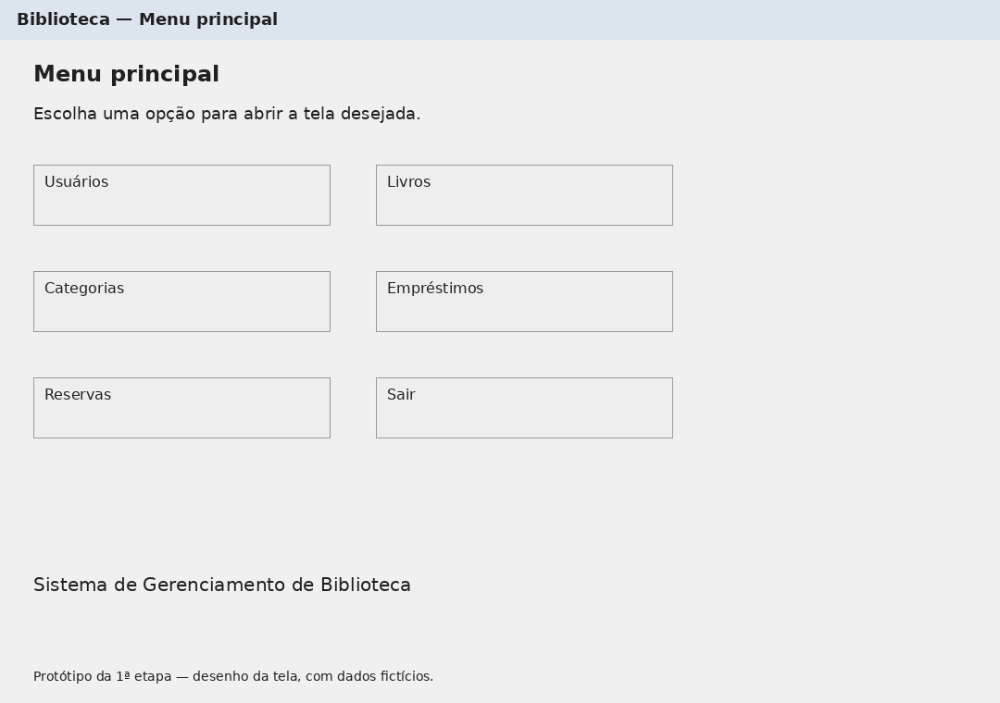
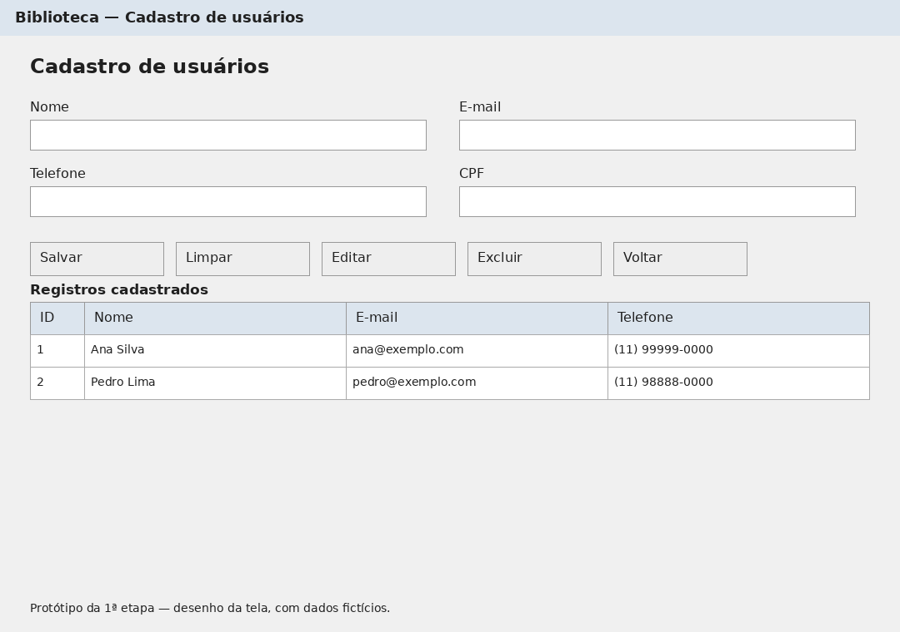
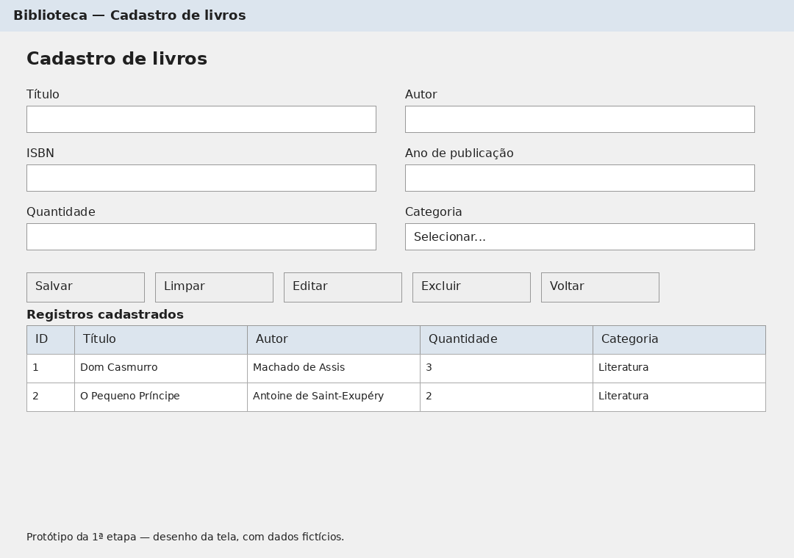
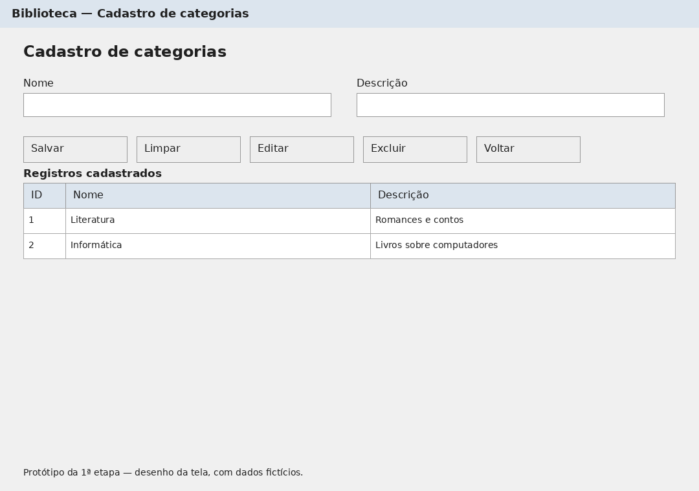
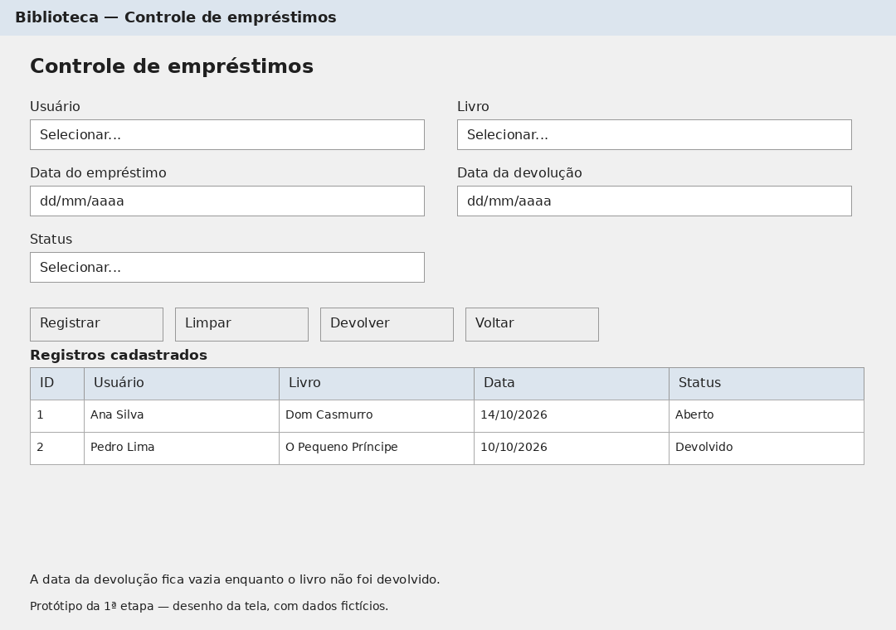
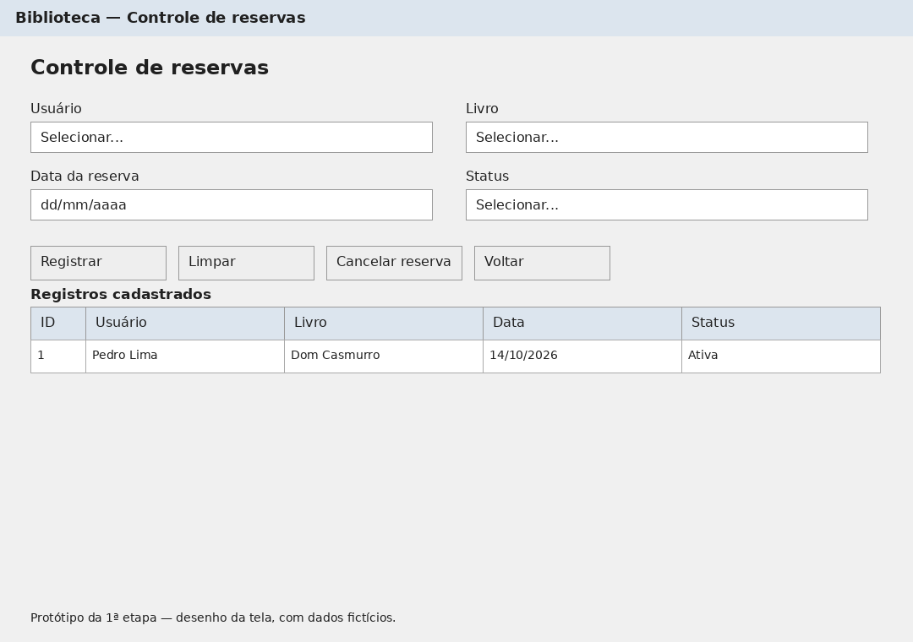
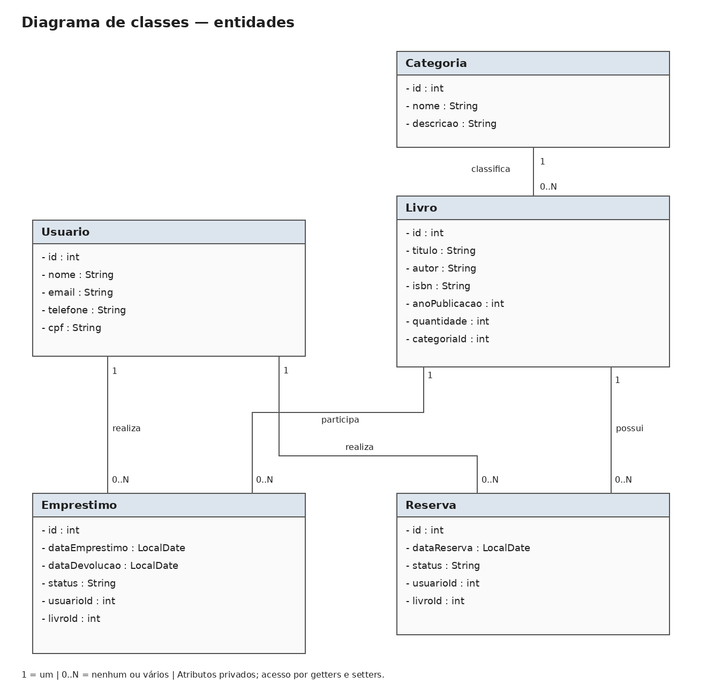
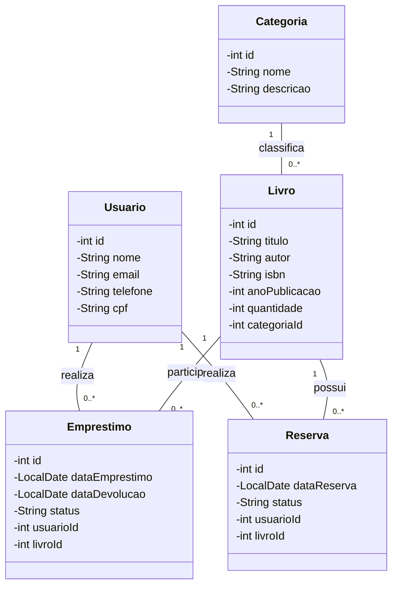
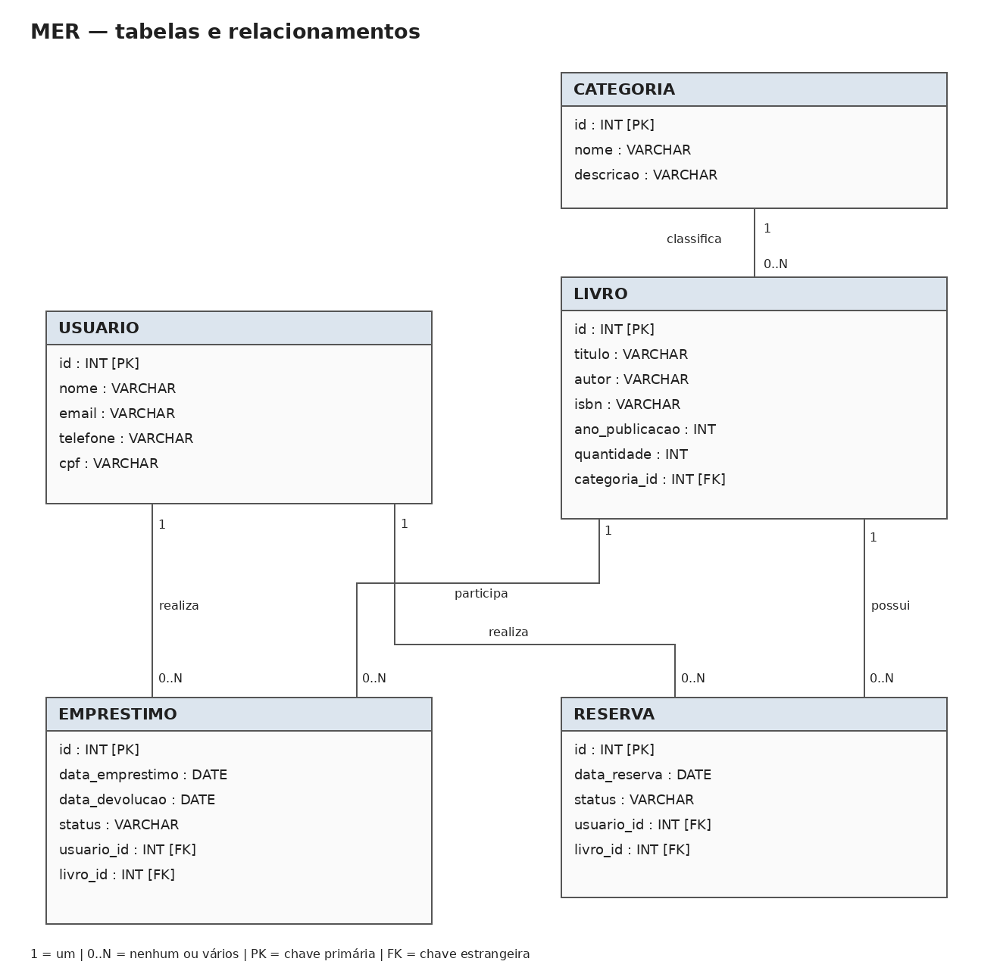
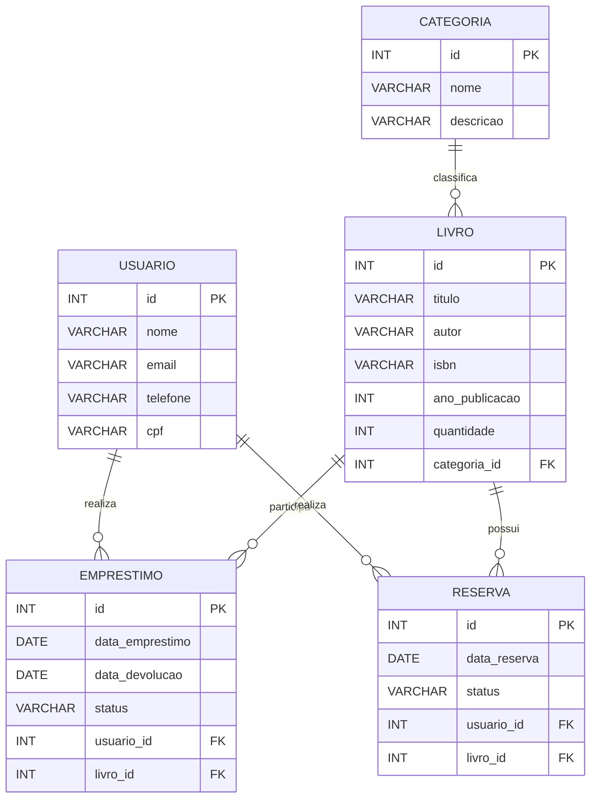

# CHAT GPT que me ajudou

# Sistema de Gerenciamento de Biblioteca

Trabalho da faculdade: Sistema Desktop com Java Swing.

## 1ª etapa — planejamento

### Tema escolhido

O sistema será usado para organizar uma biblioteca. Será possível cadastrar usuários, livros e categorias, além de registrar empréstimos e reservas de livros.

O objetivo é ajudar a saber quais livros estão cadastrados, quem pegou um livro emprestado e quem fez uma reserva.

### O que será usado

- Java e Java Swing para criar as telas.
- SQLite para guardar os dados.
- JDBC para conectar o Java ao banco de dados.
- MVC para separar os dados, as telas e as ações dos botões.

O repositório contém o planejamento da primeira etapa e o código do sistema em Java Swing com JDBC e SQLite. As imagens abaixo são os protótipos; o programa implementado usa componentes simples do Swing.

## Protótipos das telas

Os protótipos são desenhos das telas que serão criadas em Java Swing. Os nomes e os registros mostrados são exemplos fictícios. As imagens não possuem botões funcionando.

### Menu principal

Permite abrir as telas de usuários, livros, categorias, empréstimos e reservas. O botão Sair fecha o programa.



### Cadastro de usuários

Permite cadastrar, consultar, editar e excluir usuários da biblioteca. Os campos são nome, e-mail, telefone e CPF.



### Cadastro de livros

Permite cadastrar, consultar, editar e excluir livros. Cada livro terá uma categoria. A quantidade representa o total de cópias cadastradas do livro.



### Cadastro de categorias

Permite cadastrar, consultar, editar e excluir categorias, como Literatura e Informática.



### Controle de empréstimos

Permite escolher um usuário e um livro para registrar um empréstimo. O botão Devolver encerra o empréstimo selecionado e registra a data da devolução.



### Controle de reservas

Permite escolher um usuário e um livro para registrar uma reserva. O botão Cancelar reserva muda o status da reserva selecionada.



Nos cadastros, selecione uma linha da tabela antes de editar ou excluir. Salvar grava o cadastro; Limpar apaga os campos; Voltar retorna ao menu.

## Entidades do sistema

| Entidade / tabela | O que guarda |
| --- | --- |
| Usuario / usuario | Dados dos usuários da biblioteca |
| Categoria / categoria | Categorias usadas para organizar os livros |
| Livro / livro | Dados dos livros e sua quantidade total |
| Emprestimo / emprestimo | Usuário, livro, datas e situação do empréstimo |
| Reserva / reserva | Usuário, livro, data e situação da reserva |

O projeto terá cinco tabelas, atendendo ao pedido de quatro ou mais tabelas.

## Diagrama de classes

O diagrama mostra as cinco classes e seus atributos. Os atributos serão privados e terão métodos para consultar e alterar seus valores, chamados getters e setters. As datas usarão LocalDate.



<details>
<summary>Ver versão editável em Mermaid</summary>



</details>

## MER — Modelo Entidade-Relacionamento

Este modelo mostra as tabelas que serão criadas no banco, seus campos e os relacionamentos. O ID identifica cada registro. Os campos com FK ligam uma tabela à outra.



<details>
<summary>Ver versão editável em Mermaid</summary>



</details>

### Relacionamentos

- Uma categoria pode ter nenhum ou vários livros. Cada livro pertence a uma categoria.
- Um usuário pode ter nenhum ou vários empréstimos. Cada empréstimo pertence a um usuário.
- Um livro pode aparecer em vários empréstimos ao longo do tempo. Cada empréstimo registra um livro.
- Um usuário pode ter nenhuma ou várias reservas. Cada reserva pertence a um usuário.
- Um livro pode ter nenhuma ou várias reservas. Cada reserva registra um livro.

### Regras básicas

- Nome do usuário, CPF e e-mail devem ser informados. O CPF não pode se repetir.
- O livro deve ter título, autor, ISBN, ano, quantidade e categoria. O ISBN não pode se repetir.
- A quantidade de livros deve ser zero ou maior.
- Só será permitido emprestar quando houver uma cópia disponível. A disponibilidade será a quantidade total menos os empréstimos com status Aberto.
- O empréstimo terá status Aberto ou Devolvido. A data da devolução ficará vazia até a devolução acontecer; ela não representa um prazo previsto.
- A reserva terá status Ativa, Atendida ou Cancelada. Para atender uma reserva, será registrado um empréstimo e a reserva será marcada como Atendida.
- Um usuário não poderá ter duas reservas ativas para o mesmo livro.
- Ao excluir um livro, os empréstimos e reservas dele também são apagados.
- Ao excluir um usuário, os empréstimos e reservas dele também são apagados.
- Ao excluir uma categoria, todos os seus livros e os empréstimos e reservas desses livros também são apagados.
- Antes da exclusão, o programa avisa o que será apagado e pede confirmação.
- Também é possível excluir empréstimos e reservas individualmente. Excluir um empréstimo aberto libera a cópia do livro.

## Como o MVC será usado

| Parte | Função | Exemplo |
| --- | --- | --- |
| Model | Representa os dados do sistema | Usuario, Livro, Categoria, Emprestimo e Reserva |
| View | Mostra as telas para o usuário | Tela de livros e tela de usuários |
| Controller | Recebe as ações dos botões e chama as operações necessárias | Salvar um livro ou registrar uma devolução |

Na implementação, as consultas ao banco ficarão em classes DAO. Por exemplo, LivroDAO ficará responsável por salvar e buscar livros usando JDBC. O Controller chamará essas classes; a tela não fará consultas diretamente.

As telas serão montadas com JFrame, JPanel, JLabel, JTextField, JComboBox, JButton e JTable. Para organizar os componentes, serão usados BorderLayout e GridLayout.

## Arquivos desta entrega

- README.md: descrição do tema, telas, entidades e uso do MVC.
- docs/prototipos/: seis desenhos de telas.
- diagrama.png: diagrama de classes.
- mer-diagrama.png: modelo das tabelas e relacionamentos.
- docs/diagramas/classes.mmd e mer.mmd: versões editáveis dos diagramas.

## Código do sistema

O código foi separado em pastas pequenas para facilitar a leitura:

| Pasta | O que contém |
| --- | --- |
| src/main/java/br/com/biblioteca/model | As cinco classes com atributos, getters e setters |
| src/main/java/br/com/biblioteca/view | Menu e telas com campos, botões e tabelas |
| src/main/java/br/com/biblioteca/controller | Ações dos botões e conferência dos campos |
| src/main/java/br/com/biblioteca/dao | Conexão e comandos SQL para salvar e buscar dados |
| sql | Script para criar o banco e dados de exemplo opcionais |

### O que funciona

- Cadastrar, listar, editar e excluir usuários, categorias e livros.
- Registrar empréstimos e devolver livros.
- Reservar livros, cancelar reservas e atender uma reserva criando um empréstimo.
- Guardar os dados no SQLite, mantendo-os ao fechar e abrir o programa.
- Impedir empréstimos quando não houver cópias disponíveis.
- Impedir CPF/ISBN repetidos e excluir cadastros com seus registros vinculados, após confirmação.

As telas de empréstimos e reservas mostram o histórico. A data da devolução é preenchida ao clicar em Devolver; o sistema não possui multa nem prazo de atraso. CPF é conferido pela quantidade de dígitos, sem cálculo de dígitos verificadores. ISBN é obrigatório e único, sem validação de dígito verificador. A reserva não cria uma fila por ordem de chegada: a pessoa que opera o sistema escolhe qual reserva atender.

## Atualizar sem perder os cadastros

Feche o programa. Substitua somente o arquivo `Biblioteca.jar` da instalação anterior pelo novo arquivo desta entrega e abra `executar.bat`. Mantenha a pasta `dados` que já existe na instalação anterior. O programa usa o mesmo banco SQLite e não apaga registros ao iniciar.

Para excluir, clique na linha da tabela, depois em Excluir selecionado e leia a confirmação. A exclusão é permanente e inclui os vínculos indicados na mensagem. Cancelar a confirmação mantém os registros. Para manter um histórico de empréstimo, use Devolver; para manter um histórico de reserva, use Cancelar selecionada.

## Como executar no Windows

1. Extraia o ZIP inteiro em uma pasta, por exemplo `C:\TrabalhoBiblioteca`.
2. Confira que você tem Java 17 ou superior com `java -version`.
3. Abra o arquivo `executar.bat`.

Também é possível abrir o PowerShell na pasta extraída e executar:

```powershell
java -jar Biblioteca.jar
```

Para executar esta entrega pronta, não é necessário Maven, MySQL, senha de banco ou internet. O SQLite e seu conector estão incluídos no JAR. A pasta deve permitir a criação de arquivos.

O sistema cria automaticamente as cinco tabelas e guarda os dados em `dados/biblioteca.db`. O banco começa vazio: cadastre uma categoria, um usuário e um livro para começar. Os dados continuam salvos ao fechar e abrir o programa. Para fazer uma cópia de segurança, feche o programa e copie o arquivo do banco.

Esta é uma versão nova com banco SQLite. Os dados de um banco MySQL antigo não são importados automaticamente.

## Como compilar o código

Esta parte é para quem quer modificar o programa. É necessário JDK 17 e Maven.

```bash
mvn test
mvn package
java -jar target/Biblioteca.jar
```

Para abrir diretamente pelo Maven, use `mvn compile exec:java`. Para atualizar o arquivo pronto na raiz, copie `target/Biblioteca.jar` para a pasta principal depois de compilar.

O Maven precisa de internet na primeira compilação para baixar as dependências. O arquivo `src/main/resources/banco.sql` é usado na inicialização. A cópia em `sql/banco.sql` serve para consultar as tabelas. Não é necessário executar o SQL manualmente.

## Roteiro para apresentar

1. Mostre o menu com as cinco opções.
2. Cadastre uma categoria e um usuário.
3. Cadastre um livro com quantidade 1.
4. Registre um empréstimo.
5. Tente emprestar de novo para mostrar o aviso de falta de cópias.
6. Devolva o livro.
7. Registre uma reserva e use Atender selecionada para criar um empréstimo.
8. Feche e abra novamente para mostrar que os dados foram salvos.

## Explicação rápida

- O tema é gerenciamento de biblioteca.
- As telas foram feitas com Java Swing.
- O banco é SQLite, salvo em um arquivo local.
- O JDBC faz a conexão entre Java e banco.
- Existem cinco tabelas: usuário, categoria, livro, empréstimo e reserva.
- No MVC, Model representa os dados, View mostra as telas e Controller cuida dos botões.
- As classes DAO possuem os comandos SQL.

## Conferência do trabalho

| Pedido | Onde foi atendido |
| --- | --- |
| Java Swing | Menu e cinco telas de cadastro e controle |
| Banco de dados | SQLite por JDBC, em dados/biblioteca.db |
| Quatro ou mais tabelas | Cinco tabelas criadas automaticamente |
| Várias telas | Menu, usuários, categorias, livros, empréstimos e reservas |
| MVC | Pastas model, view e controller |
| Tema, protótipos e diagramas | README, docs/prototipos e imagens dos diagramas |

No MER, INT representa os números inteiros. O SQLite usa INTEGER nos campos de ID. As datas são guardadas como texto no formato aaaa-MM-dd; DATE indica o tipo de informação representada. O SQLite aceita as declarações VARCHAR, mas não limita automaticamente o tamanho: os Controllers conferem os campos.

## Testes

O código foi compilado para Java 17. Os quinze testes usam o SQLite real em arquivos temporários, incluindo cadastros, vínculos, empréstimos, devoluções, reservas, datas, concorrência, botões e persistência ao reinicializar. Não alteram dados/biblioteca.db. A janela completa ainda deve ser conferida no Windows onde será apresentada.

## Publicar no GitHub

Envie o código-fonte, pom.xml, scripts, README e a pasta docs. A pasta dados não deve ser enviada: ela contém os registros cadastrados. O arquivo pronto Biblioteca.jar pode ser disponibilizado como anexo em uma Release do GitHub. Ele está no .gitignore para evitar colocar o binário no histórico do código.

## Fontes das ferramentas

- SQLite JDBC: https://github.com/xerial/sqlite-jdbc
- SQLite: https://www.sqlite.org/docs.html
